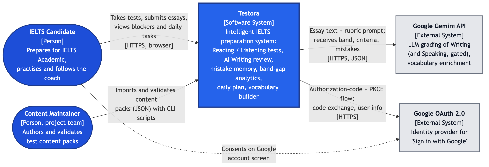
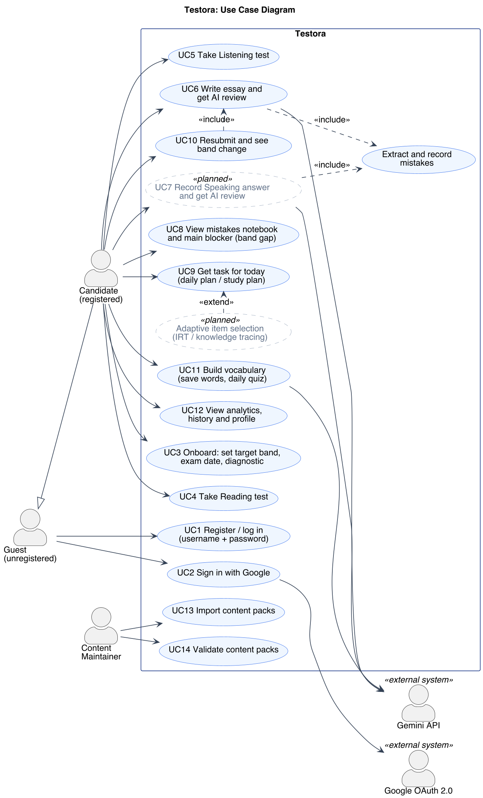
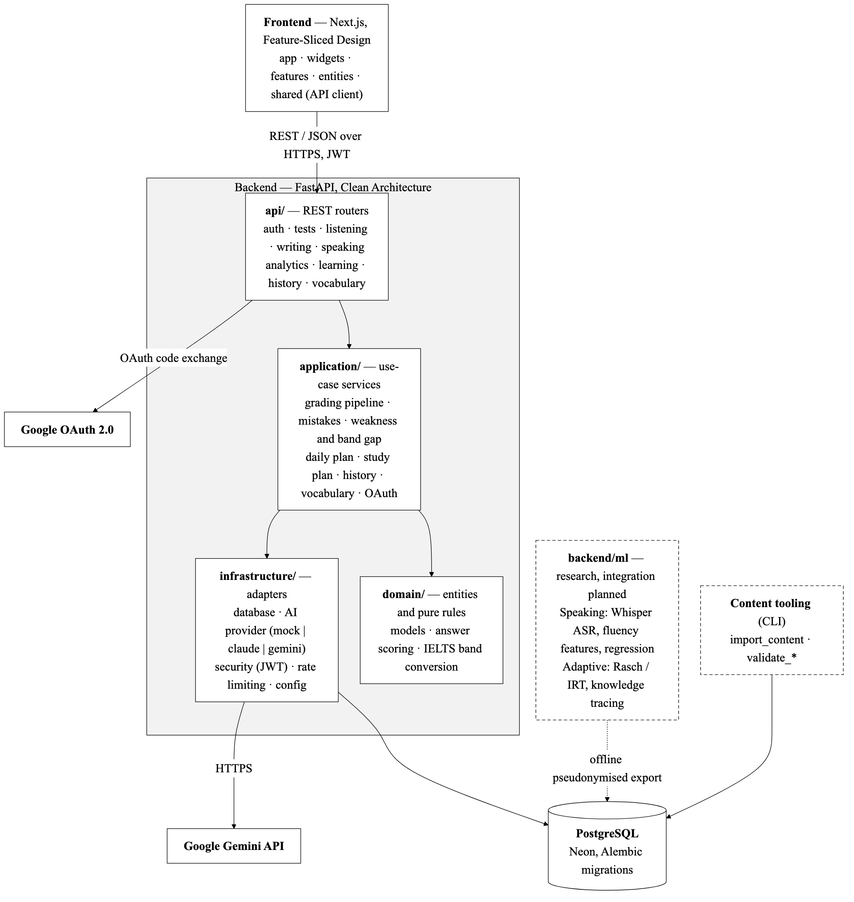
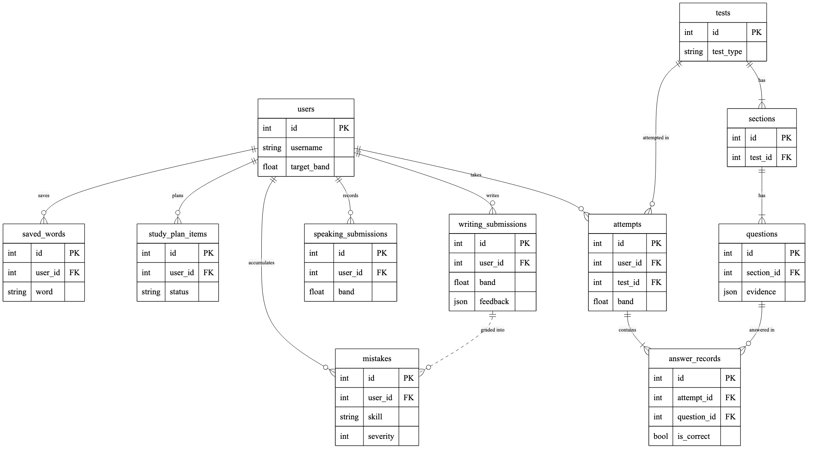
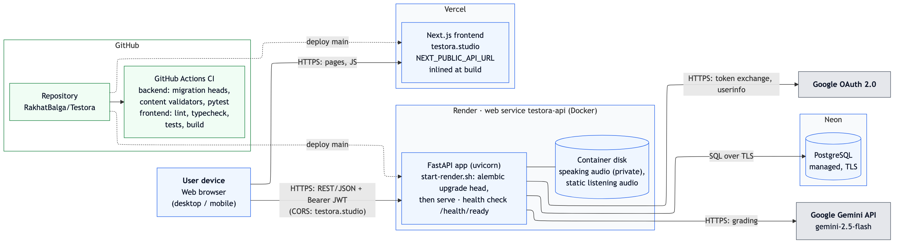

# 7. Architecture and Diagrams

This section describes the architecture of Testora as it is implemented in the repository `RakhatBalga/Testora` (branch `main`; paths follow the layout of October 2026). Component, route and table names below were checked against the source code. Where something is planned or exists only as research code, it is marked as such.

All diagrams have an editable source and two exports in `diagrams/`:

| Diagram | Editable source | Exports | Notation |
|---|---|---|---|
| System context (C4 level 1) | `diagrams/context.mmd` | `context.png`, `context.svg` | Mermaid flowchart, C4 conventions |
| Use case | `diagrams/use-case.puml` | `use-case.png`, `use-case.svg` | UML (PlantUML) |
| Component (draft) | `diagrams/component.mmd` | `component.png`, `component.svg` | Mermaid flowchart, UML-style components |
| Deployment | `diagrams/deployment.mmd` | `deployment.png`, `deployment.svg` | Mermaid flowchart (ELK layout) |
| Key data entities (ER) | `diagrams/er.mmd` | `er.png`, `er.svg` | Mermaid ER diagram, crow's foot |

To re-render: `npx -y @mermaid-js/mermaid-cli@11.4.2 -i <name>.mmd -o <name>.png -w 1600 -b white -s 2` (same command with `.svg`), and `java -jar plantuml.jar -tpng -tsvg use-case.puml` for the use case diagram.

## 7.1 Architectural overview

Testora is a web application with three runtime parts and two external services:

- **Frontend**: a Next.js (App Router, TypeScript) single-page experience, served by Vercel at `testora.studio`.
- **Backend API**: a FastAPI (Python) service in a Docker container on Render (`testora-api`). It exposes a REST/JSON API grouped into ten routers.
- **Database**: PostgreSQL (managed by Neon in production). The schema is versioned with Alembic migrations (`backend/alembic/versions/`).
- **External services**: the Google Gemini API grades Writing (and Speaking, once enabled) and enriches vocabulary. Google OAuth 2.0 provides "Sign in with Google". A self-hosted Qwen model (OpenAI-compatible server) is implemented as an alternative provider but is not used in production and is not yet measured; see 7.1.1 and [qwen.md](qwen.md).

The product is built around a **coach loop**: grade, extract mistakes, name the band blocker, tell the user what to do today, re-grade, show the band change. The architecture is designed so that this loop is deterministic and explainable. The LLM is called only at grading time. All read-time analytics (weakness scores, band gap, daily plan) are pure aggregations over stored data, with no AI calls.

### 7.1.1 Architectural style and rationale

| Decision | What it means in the code | Why |
|---|---|---|
| **Clean Architecture in the backend** | `backend/app/` is split into `api/` (routers, Pydantic schemas, dependencies), `application/` (use-case services), `domain/` (SQLAlchemy entities and pure scoring rules) and `infrastructure/` (database, AI adapters, security, rate limiting, config, logging). | Business rules such as answer checking (`domain/scoring.py`, `domain/listening_scoring.py`) and raw-score-to-band conversion (`domain/band.py`) do not depend on HTTP or on a specific AI vendor. They can be unit-tested in isolation; the backend test suite (`backend/tests/`) does this. Routers stay thin and only orchestrate. |
| **Feature-Sliced Design (FSD) in the frontend** | `frontend/src/` has the layers `app/` (routes), `widgets/` (page composition), `features/` (user workflows), `entities/` (domain models and UI) and `shared/` (API client, auth, UI kit, config, lib). A layer may import only from layers below it. Slices export through `index.ts` barrels. | Keeps a growing UI (Reading, Listening, Writing, dashboard, vocabulary) modular. All backend access goes through `shared/api`, so pages never call `fetch` directly and the API contract lives in one place. |
| **Provider-independent AI layer** | `infrastructure/ai/base.py` defines the `WritingGrader` and `SpeakingGrader` interfaces and the `Feedback` and `MistakeItem` types. `infrastructure/ai/factory.py` picks `mock`, `claude`, `gemini` or `qwen` from the environment variable `AI_PROVIDER` (`qwen`: a self-hosted model behind an OpenAI-compatible API, `qwen.py` and `openai_compat.py`; setup in [qwen.md](qwen.md)). Prompts and response schemas live in `prompts.py` and `schemas.py`; one shared engine (`engine.py`) applies the same normalisation and scoring rules (half-band snapping, recomputed overall, hard caps, verbatim mistake check, prompt-injection hardening) to every provider. Hard caps come from the examiner's own findings (off-topic, missing overview, fabricated data) and from the code-checked word count; the code's own heuristics for overview wording, topic overlap and injection phrasing are recorded only as diagnostic flags and never lower a band, because they misfire on legitimate essays. The examiner prompt version is selectable (`EXAMINER_PROMPT_VERSION=v1|v2`) and recorded with every result. Each result stores diagnostics (`prompt_version`, provider, model, caps applied, unverified snippets) in the submission's feedback JSON. | The LLM vendor can be changed by configuration, without code changes. Development and CI run on the free deterministic `mock` grader. Production uses Gemini (`render.yaml`: `AI_PROVIDER=gemini`, `GEMINI_MODEL=gemini-2.5-flash`, `GEMINI_FAST_MODEL=gemini-2.5-flash-lite`). Qwen replaces Gemini only if experiment E1 shows comparable accuracy; with `AI_PROVIDER=qwen`, `/health/ready` also pings the Qwen server. A startup guard in `main.py` refuses to start in production if the effective provider would be `mock`. |
| **Deterministic analytics** | `application/analytics/*` (weakness, band_gap, daily_plan, recommendations, …) read only from the `mistakes`, submission and attempt tables. | Results are reproducible, cheap (no per-view LLM cost) and explainable: every daily-plan task carries a `source` that names the signal it came from. |
| **Research code separated from production** | `backend/ml/` (Speaking ASR and fluency features, Rasch/IRT, Bayesian knowledge tracing, offline recommendation, metrics) is a separate package. Its `__init__.py` states that it is never imported by the production grading factory. | Experimental models can be evaluated offline on exported data without risking production stability. They will be integrated only after they reach the agreed quality metrics. |

## 7.2 System context diagram (C4 level 1)

*Figure 7.1. Testora in its environment. Source: `diagrams/context.mmd`.*

| Element | Type | Interaction with Testora |
|---|---|---|
| IELTS Candidate | Person | Uses the web app over HTTPS. Takes Reading and Listening tests, submits essays, reviews mistakes, follows the daily plan, trains vocabulary. |
| Content Maintainer (project team) | Person | Prepares content packs (JSON under `backend/content/`). Imports them with `python -m content_tools.importer` and checks them with `python -m content_tools.validate_reading`, `validate_listening` and `validate_writing`. There is no admin web UI; content management is done through scripts on purpose. |
| Google Gemini API | External system | Receives the essay text with a rubric prompt and returns band scores for the four IELTS criteria plus a list of mistakes as structured JSON. Also used for vocabulary enrichment (`GeminiVocabularyCoach`). |
| Google OAuth 2.0 | External system | Authorization-code flow with PKCE (S256). The backend creates the authorization URL and state (`application/oauth.py`), then exchanges the code and reads user info (`application/google_auth.py`, called from `api/routers/auth.py`; token endpoint `https://oauth2.googleapis.com/token`). It works in production only when the `GOOGLE_*` variables are set on Render and `NEXT_PUBLIC_GOOGLE_CLIENT_ID` on Vercel. |

The system sends no email and has no payment provider.

## 7.3 Use case diagram

*Figure 7.2. Use cases. Dashed, grey ellipses marked «planned» are not yet available to users. Source: `diagrams/use-case.puml`.*

**Actors**

- **Guest (unregistered)**: can register with username and password, or sign in with Google.
- **Candidate (registered)**: specialises Guest (generalisation arrow) and has access to all learning use cases.
- **Content Maintainer**: imports and validates content packs from the command line.
- **Google OAuth 2.0** and **Gemini API**: secondary (supporting) actors.

**Use cases and their status**

| ID | Use case | Status | Main API routes |
|---|---|---|---|
| UC1 | Register / log in (username + password) | Implemented | `POST /auth/register`, `POST /auth/login`, `GET /auth/me` |
| UC2 | Sign in with Google | Implemented | `POST /auth/google/start`, `POST /auth/google`, `POST /auth/username` |
| UC3 | Onboard: set target band, exam date, diagnostic | Implemented | `PATCH /auth/me`, `/learning/diagnostic/*` |
| UC4 | Take Reading test | Implemented | `GET /tests`, `GET /tests/{id}`, `POST /results/submit`, `GET /results/{id}` |
| UC5 | Take Listening test | Implemented | `GET /listening/tests`, `PUT /listening/tests/{id}/progress`, `POST /listening/tests/{id}/submit`, `GET /listening/attempts/{id}` |
| UC6 | Write essay and get AI review | Implemented (Gemini) | `GET /writing/tasks`, `GET /writing/quota`, `POST /writing/submit`, `GET /writing/submissions/{id}` |
| UC7 | Record Speaking answer and get AI review | **Planned**: backend routes and `GeminiSpeakingGrader` exist, but the UI is switched off (`SPEAKING_AVAILABLE = false` in `frontend/src/app/speaking/page.tsx`). The Whisper-based pipeline is research code in `backend/ml/`. | `/speaking/*` |
| UC8 | View mistakes notebook and main blocker (band gap) | Implemented | `GET /learning/mistakes`, `PATCH /learning/mistakes/{skill}/{source_id}`, `GET /analytics/blockers`, `GET /analytics/band-gap`, `GET /analytics/weaknesses` |
| UC9 | Get task for today (daily plan / study plan) | Implemented | `GET /analytics/daily-plan`, `GET /learning/study-plan`, `PATCH /learning/study-plan/{item_id}` |
| UC10 | Resubmit and see band change | Implemented (Writing) | `POST /writing/submit` (new attempt), `POST /writing/submissions/{id}/retry` (re-grade a failed review), `GET /analytics/progress-impact`, `GET /history/compare` |
| UC11 | Build vocabulary (save words, daily quiz) | Implemented | `POST /vocabulary/words`, `POST /vocabulary/words/{id}/enrich`, `GET /vocabulary/daily-quiz`, `POST /vocabulary/daily-quiz/submit` |
| UC12 | View analytics, history and profile | Implemented | `GET /analytics/band-trajectory`, `/analytics/streak`, `/analytics/weekly-weakest`, `GET /history`, `GET /auth/me` |
| UC13 | Import content packs | Implemented (CLI) | `backend/content_tools/importer.py` |
| UC14 | Validate content packs | Implemented (CLI, also run in CI) | `backend/content_tools/validate_reading.py`, `validate_listening.py`, `validate_writing.py` |
| – | Adaptive item selection (IRT / knowledge tracing) | **Planned**: offline research in `backend/ml/irt.py`, `knowledge_tracing.py`, `recommendation.py`; would extend UC9 | – |

"Extract and record mistakes" is an included use case of UC6 (and UC7): every successful grade writes rows to the `mistakes` table through `application/mistakes.py`. UC10 includes UC6 because a resubmission goes through the same grading pipeline.

## 7.4 Component diagram (draft)

*Figure 7.3. Main components and their dependencies. Arrows mean "depends on / calls". Source: `diagrams/component.mmd`.*

### 7.4.1 Frontend (`frontend/src`)

| Layer | Slices (actual folder names) | Responsibility |
|---|---|---|
| `app/` | `page.tsx` (dashboard or landing), `login`, `register`, `reading/[id]`, `listening/[id]`, `writing/[id]`, `speaking`, `mistakes`, `study-plan`, `vocabulary`, `analytics`, `history`, `profile`, `mock-tests`, `practice`, `tests/[type]`, `result/[id]` | Routing, page-level data loading |
| `widgets/` | `app-shell`, `coach-dashboard`, `landing` | Composition of features into screens; the coach dashboard shows the blocker, weaknesses, recommendations and blocker history |
| `features/` | `auth`, `reading-session`, `listening-session`, `test-session`, `writing-task`, `feedback`, `mistake-notebook`, `study-plan`, `vocabulary`, `progress-impact`, `streak`, `coach-dashboard`, `avatar-crop` | User workflows: timed test sessions, essay feedback display, essay comparison, Google sign-in flow |
| `entities/` | `coach`, `dashboard`, `test` | Frontend domain models and small entity UI (test cards, recent activity) |
| `shared/` | `api` (typed client), `auth`, `ui`, `config`, `lib` | HTTP client with JWT bearer header, auth context, UI kit, IELTS constants |

### 7.4.2 Backend (`backend/app`)

| Layer | Components | Responsibility |
|---|---|---|
| `api/routers` | `auth`, `tests`, `results`, `listening`, `writing`, `speaking`, `analytics`, `learning`, `history`, `vocabulary`; `api/dependencies.py` (`get_db`, `get_current_user`) | HTTP endpoints, request validation (Pydantic schemas in `api/schemas/`), authentication of every protected route |
| `application` | `writing`, `speaking`, `attempts`, `accounts`, `google_auth`, `ai_gate`, `writing_precheck`, `quota`, `mistakes`, `analytics/` (`weakness`, `band_gap`, `daily_plan`, `recommendations`, `progress`, `trajectory`, `streak`, `weekly`, `blocker_history`, `sources`, `links`), `learning/` (`dashboard`, `diagnostic`, `study_plan`, `notebook`), `history/`, `comparison/`, `vocabulary`, `oauth`, `listening/calibration` | Use cases: grading pipeline, mistake memory, band gap, daily and weekly plans, diagnostics, vocabulary training, AI-usage quotas |
| `domain` | `models/` (`user`, `test`, `attempt`, `writing`, `speaking`, `mistake`, `learning`, `vocabulary`, `ai_quota`, `oauth`), `scoring.py`, `listening_scoring.py`, `band.py` | Persistent entities and pure IELTS rules (answer normalisation and checking, raw score to band, rounding to 0.5) |
| `infrastructure` | `ai/` (`factory`, `engine`, `gemini`, `qwen`, `openai_compat`, `claude`, `mock`, `prompts`, `schemas`, `vocab`, `concurrency`), `storage/` (avatars and audio in PostgreSQL or local disk), `database`, `security`, `ratelimit`, `config`, `logging`, `errortracking`, `time` | Adapters for PostgreSQL (SQLAlchemy), LLM providers, JWT, rate limiting, settings, structured logs, optional Sentry |

**Content tooling** (`backend/`): `content_tools/importer.py`, the three `content_tools/validate_*.py` validators, demo seeding in `scripts/seed/` and Alembic migrations. They are run by the content maintainer and by CI; migrations also run at container start (`start-render.sh` runs `alembic upgrade head`).

**ML research package** (`backend/ml/`, integration planned):
- Speaking: `asr.py` (optional faster-whisper adapter), `speech_features.py` (fluency features such as words per minute, pause ratio, filler ratio), `train_speaking.py` (baseline, linear regression and gradient boosting, evaluated on held-out speakers with MAE, QWK and half-band accuracy), `benchmark_asr.py` (WER).
- Adaptive learning: `irt.py` (regularised Rasch 1PL), `knowledge_tracing.py` (Bayesian knowledge tracing per question type), `recommendation.py` (explainable offline ranking of candidate items), `evaluate_adaptive.py` (chronological, predict-before-update evaluation with AUC).
- Shared: `data.py` (versioned, pseudonymous records), `metrics.py`, `export_responses.py` (pseudonymised export of Reading and Listening outcomes using a secret key).
- Writing evaluation (experiment E1, Section 9): `writing_data.py` (dataset schema, deduplication, prompt-grouped splits), `collect_writing.py` (cached provider runs), `train_writing.py` (Ridge and gradient-boosting baselines), `evaluate_writing.py` and `writing_stats.py` (QWK, MAE, agreement, bootstrap intervals, stability), `graders.py` (provider lookup, shared with the production factory names).

## 7.5 Main data flow: the coach loop

The steps below follow one Writing submission through the system. Reading and Listening follow the same loop, except that step 3 is deterministic answer checking (`domain/scoring.py`, `domain/listening_scoring.py`) and wrong answers are stored as `answer_records` with `is_correct = false`.

1. **Submit.** The `writing-task` feature calls `POST /writing/submit` through `shared/api`. `get_current_user` validates the JWT.
2. **Pre-check and quota.** `application/writing_precheck.py` deterministically rejects text that should never reach an examiner (non-English, empty or gibberish, too short to count as a serious attempt) and gives it Band 0 without calling the model. `application/quota.py` enforces the free AI-review limit (`FREE_WRITING_SUBMISSIONS`) and reserves the call (`ai_quota_buckets`, `ai_reservations`), so parallel requests cannot exceed the limit.
3. **Grade.** `infrastructure/ai/factory.get_writing_grader()` returns `GeminiWritingGrader` in production. The call runs in a thread pool with a global concurrency bound (`ai/concurrency.py`). It returns `Feedback`: an overall band, the four IELTS criteria and a list of `MistakeItem`. An improved version of the essay is generated in parallel. If grading fails, the submission is saved with `status = "failed"` and **no band**, so it never appears as Band 0 in analytics. The user can re-grade it with `POST /writing/submissions/{id}/retry`.
4. **Record mistakes.** `application/mistakes.record_mistakes()` writes one `mistakes` row per item: skill, category, subskill, severity 1–3, snippet, correction and explanation.
5. **Weakness score.** `application/analytics/weakness.py` groups mistakes by (skill, category, subskill) and computes `score = 1 − 0.5^(Σ severity · decay(age) / opportunities)`, with `decay(age) = 0.5^(age_days / 14)` (14-day half-life). A weakness is *recurring* if it appears in at least 3 recent attempts.
6. **Band gap and blocker.** `application/analytics/band_gap.py` computes the overall band as the mean of the per-skill bands rounded to 0.5, compares it with the user's `target_band`, picks the lowest skill (highest leverage), and inside Writing/Speaking the lowest criterion becomes the named **blocker**. The explanation is taken from real recurring mistakes.
7. **Task for today.** `application/analytics/daily_plan.py` builds the day's tasks from the blocker, the weakest skill, the top recurring mistake and skills not practised for 3 or more days. Each task has a `source` field. `application/learning/study_plan.py` keeps a weekly plan in `study_plan_items`.
8. **Re-grade and band change.** After a new submission, `GET /analytics/progress-impact` and `GET /history/compare` show how the band and criteria moved compared with earlier attempts. The dashboard (`widgets/coach-dashboard`) also shows the band trajectory.

## 7.6 Key data entities

*Figure 7.4. Key tables (subset of columns). Source: `diagrams/er.mmd`.*

Content tables (`tests` → `sections` → `questions`, `writing_tasks`, `speaking_tasks`) are filled by the import scripts. User activity is stored in `attempts` and `answer_records` (Reading and Listening), `writing_submissions` and `speaking_submissions`. `mistakes.submission_id` is a polymorphic reference: the `skill` column tells which submission table it points to, so there is no foreign key on it. Supporting tables not shown in the figure: `listening_progress` (resume a Listening test), `diagnostic_sessions`, `ai_reservations` and `oauth_flows` (short-lived PKCE state).

## 7.7 Deployment view

*Figure 7.5. Production deployment. Source: `diagrams/deployment.mmd`.*

- **Vercel** hosts the Next.js frontend at `testora.studio`. The API base URL (`NEXT_PUBLIC_API_URL`) is inlined at build time.
- **Render** runs the backend Docker image (`backend/Dockerfile`). `start-render.sh` applies migrations (`alembic upgrade head`) and then starts uvicorn. Render's health check uses `/health/live` (readiness would query the database and keep the Neon compute awake); `/health/ready` checks the database connection and that a real grader is configured, and is meant for a low-frequency external monitor. Render deploys `main` only after the GitHub checks pass (`autoDeployTrigger: checksPass`).
- **Neon** provides managed PostgreSQL over TLS (`DATABASE_URL`).
- **GitHub Actions** (`.github/workflows/ci.yml`) runs on every pull request and push to `main` with four jobs: `backend` (ruff, migration single-head check, upgrade/downgrade/upgrade on PostgreSQL 16, `alembic check`, content validators, `pytest`), `frontend` (lint, typecheck, tests, build), `backend-image` (Docker build without push) and `compose-config`. Branch protection on `main` requires `backend`, `frontend` and `compose-config`. `docker-compose.yml` runs the full stack locally and can serve as a self-hosted alternative (Postgres + API + frontend).

## 7.8 Alignment: requirements, use cases, components and data

| Requirement / use case | Frontend (FSD slice) | API router | Application / domain component | Data entities |
|---|---|---|---|---|
| Account and sign-in (UC1, UC2) | `features/auth`, `shared/auth` | `auth` | `application/oauth`, `infrastructure/security`, `infrastructure/ratelimit` | `users`, `oauth_flows` |
| Personal target and level (UC3) | `app/register`, `app/profile` | `auth`, `learning` | `application/learning/diagnostic` | `users` (`target_band`, `current_level`, `exam_date`), `diagnostic_sessions` |
| Reading practice with automatic scoring (UC4) | `features/reading-session`, `features/test-session` | `tests`, `results` | `domain/scoring`, `domain/band` | `tests`, `sections`, `questions`, `attempts`, `answer_records` |
| Listening practice with resume (UC5) | `features/listening-session` | `listening` | `domain/listening_scoring`, `domain/band` | `tests`, `sections`, `questions`, `attempts`, `answer_records`, `listening_progress` |
| AI essay review with criteria and mistakes (UC6) | `features/writing-task`, `features/feedback` | `writing` | `application/writing_precheck`, `application/quota`, `infrastructure/ai` (Gemini), `application/mistakes` | `writing_tasks`, `writing_submissions`, `mistakes`, `ai_quota_buckets`, `ai_reservations` |
| Speaking review (UC7, planned) | `app/speaking` (gated) | `speaking` | `infrastructure/ai` (`GeminiSpeakingGrader`); research: `ml/asr`, `ml/speech_features`, `ml/train_speaking` | `speaking_tasks`, `speaking_submissions`, `mistakes` |
| Mistake memory and main blocker (UC8) | `features/mistake-notebook`, `widgets/coach-dashboard` | `learning`, `analytics` | `application/learning/notebook`, `analytics/weakness`, `analytics/band_gap`, `analytics/blocker_history` | `mistakes`, `mistake_reviews`, `answer_records`, submission tables |
| Task for today (UC9) | `features/study-plan`, `widgets/coach-dashboard` | `analytics`, `learning` | `analytics/daily_plan`, `analytics/recommendations`, `learning/study_plan` | `study_plan_items`, `mistakes`, `attempts`, submission tables |
| Re-grade and band change (UC10) | `features/progress-impact`, `features/feedback` (essay comparison) | `writing`, `analytics`, `history` | `analytics/progress`, `application/comparison`, `application/history` | `writing_submissions`, `mistakes` |
| Vocabulary builder (UC11) | `features/vocabulary` | `vocabulary` | `application/vocabulary`, `infrastructure/ai/vocab` | `saved_words`, `daily_word_quizzes` |
| Analytics and history (UC12) | `app/analytics`, `app/history`, `features/streak` | `analytics`, `history` | `analytics/trajectory`, `analytics/streak`, `analytics/weekly` | `attempts`, submission tables, `mistakes` |
| Content import and validation (UC13, UC14) | – | – (CLI) | `content_tools/importer.py`, `content_tools/validate_*.py`, run in CI | `tests`, `sections`, `questions`, `writing_tasks`, `speaking_tasks` |
| Adaptive selection (planned) | – | – | `ml/irt`, `ml/knowledge_tracing`, `ml/recommendation`, `ml/evaluate_adaptive` | offline export of `attempts` and `answer_records` (`ml/export_responses`) |

Every use case in Figure 7.2 appears in this table, and every API router and application package in Figure 7.3 serves at least one use case. Every table in Figure 7.4 is written or read by at least one listed component.

## 7.9 Security and privacy

- **Authentication.** Passwords are hashed with bcrypt. The API issues JWT access tokens (HS256, PyJWT) whose claims include the user id, a version, a type, expiry and issue time; `security.access_token_user_id` rejects tokens with the wrong version, type or subject format; `POST /auth/logout` revokes a user's tokens by bumping a token version. Passwords are limited to 72 bytes (bcrypt). In production the app refuses to start if `SECRET_KEY` is missing, shorter than 32 characters, or a known placeholder or leaked value. On the frontend the token is stored in `sessionStorage`, not in persistent `localStorage`; old `localStorage` keys are migrated and removed.
- **Google sign-in.** Authorization-code flow with PKCE (S256). The `state` is stored only as a SHA-256 hash in `oauth_flows` and is bound to the redirect URI. The code is exchanged on the server, so the client never sees Google tokens.
- **Abuse protection.** `/auth/register`, `/auth/login`, `/auth/google/start` and `/auth/google` are rate-limited per client, and AI and upload routes have per-user limits (all in-process). The client IP is the right-most `X-Forwarded-For` hop that is not in `TRUSTED_PROXY_CIDRS`. Request bodies above 1 MB are rejected with 413. `X-Forwarded-For` is trusted only from `TRUSTED_PROXY_CIDRS`. AI-backed actions are limited by per-user quotas with reservations (`application/quota.py`) and by a global daily AI budget (`AI_GLOBAL_DAILY_ATTEMPTS`); both fail closed. Essay length and audio upload size are capped (`MAX_WRITING_CHARS`, `MAX_AUDIO_UPLOAD_MB`).
- **Access control.** Every user-data route depends on `get_current_user`, and queries filter by `user_id`. Speaking recordings and avatars are stored privately in PostgreSQL (`stored_files`) and recordings are served only to their owner through an authenticated endpoint (`GET /speaking/submissions/{id}/audio`). The frontend fetches them with an Authorization header, so tokens never appear in URLs.
- **Transport and exposure.** HTTPS everywhere. CORS allows only `https://testora.studio` and `https://www.testora.studio`. Interactive API docs (`/docs`, `/redoc`, `/openapi.json`) are disabled in production.
- **Data sent to third parties.** For grading, Gemini receives the essay text and the task prompt; the username and email are not part of the prompt. Vocabulary enrichment sends the saved word, its context sentence and the user's native language. Google receives only what is needed for OAuth.
- **Research data.** `ml/export_responses.py` pseudonymises users with a keyed hash. Exports contain no names, emails, answer text or answer keys, and raw research data is kept out of Git.
- **Failure honesty.** Failed AI grades are stored without a band and excluded from analytics. The service will not start in production with the mock grader.

**Known limitations.** Rate limiting is per process: if the backend is scaled to several instances, a shared store (for example Redis) or proxy-level limiting will be needed. The Render free plan has an ephemeral container disk, which is why avatars and audio are stored in the database (`STORAGE_BACKEND=database`); this is acceptable for a pilot and should move to object storage if Speaking is used at scale. Database backups are manual (see `operations.md`).
