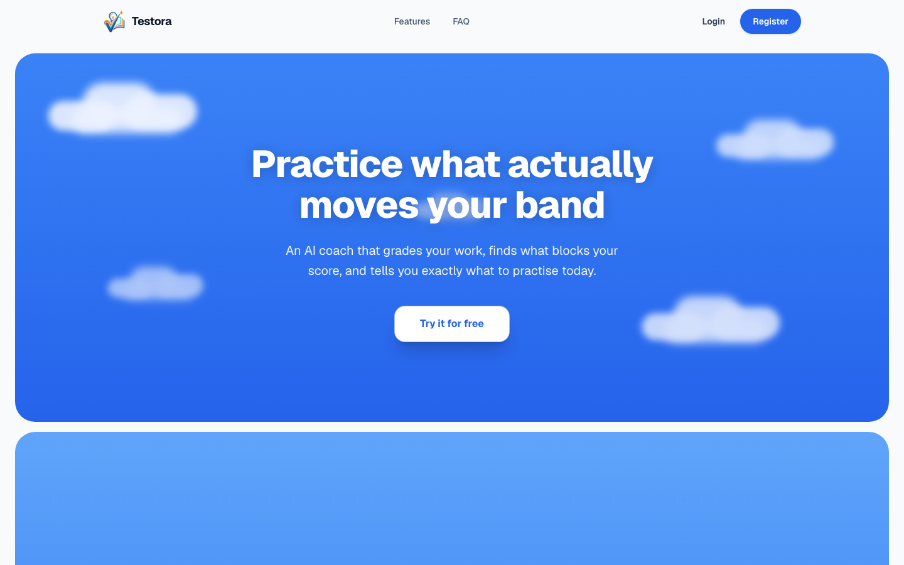
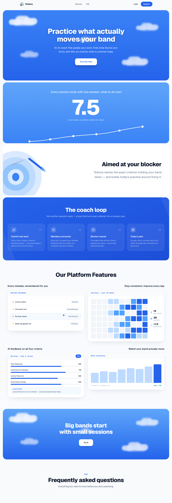
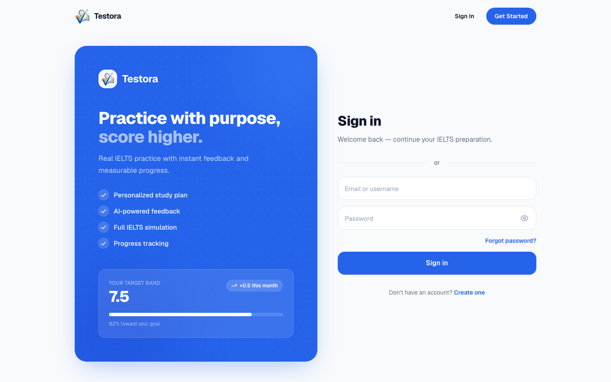
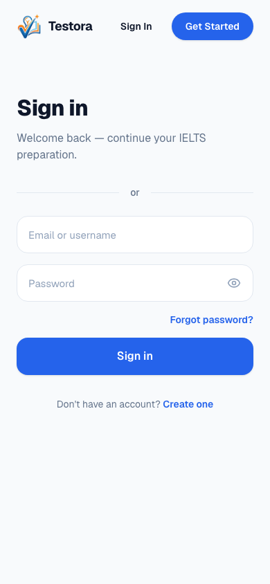
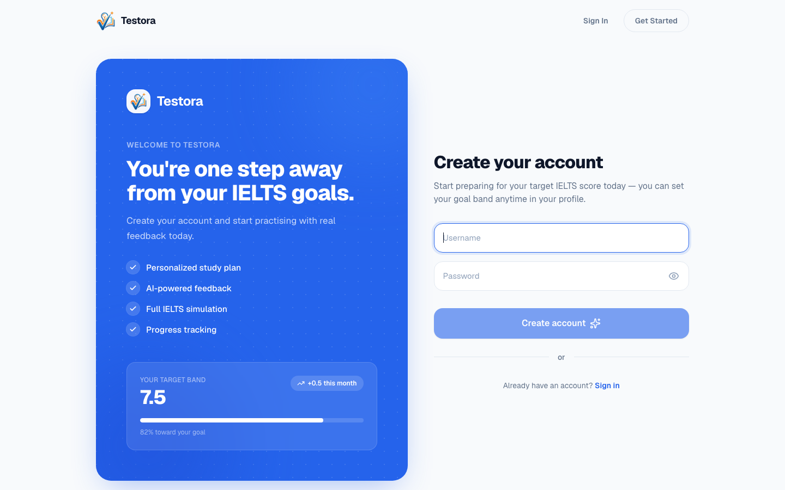
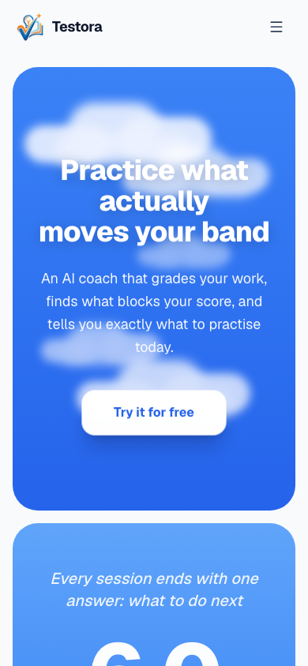

# 8. UX and Prototype

Testora has no separate clickable mock-up. The working product at **https://testora.studio** is the prototype. This section shows how a learner moves through the main scenarios. Each step names the real route (`frontend/src/app/...`) and the backend endpoint behind it, so every screen described here exists in the code.

**Screenshots.** The images below are real headless-Chrome captures of the **public** pages of testora.studio, taken on 22 October 2026 at 1440×900 (desktop) and 390×844 (phone). We did not log in or create accounts. Screens behind login are marked *"Screenshot to be added by the team"*, with a description of what the capture should show. No screenshot here is a mock-up.

## 8.1 Information architecture

| Area | Route(s) | Purpose |
|------|----------|---------|
| Public | `/` (landing when logged out), `/login`, `/register`, `/auth/google/callback` | Explain the coach loop and create an account |
| Dashboard | `/` (when logged in) | Target band, current level, exam countdown, **task for today**, weekly plan, recent practice |
| Practice hub | `/practice` → `/reading`, `/listening`, `/writing`, `/speaking` | Choose a skill |
| Writing | `/writing` → `/writing/[id]` → `/writing/result/[id]` | Task list → timed editor → AI review |
| Reading | `/reading` → `/reading/[id]` → `/reading/result/[id]` | Catalogue → timed test → review with evidence |
| Listening | `/listening` → `/listening/[id]` → `/listening/result/[id]` | Audio test with saved progress → review |
| Speaking | `/speaking` → `/speaking/[id]` → `/speaking/result/[id]` | **Gated:** shows "temporarily unavailable" (`SPEAKING_AVAILABLE = false`) |
| Coach views | `/analytics`, `/study-plan`, `/mistakes`, `/history`, `/history/compare` | Main limiter, recommendations, trajectory, plan, mistakes, attempt comparison |
| Vocabulary | `/vocabulary` | Saved words, AI enrichment, training list, daily quiz |
| Account | `/profile` | Goal, exam date, study days, focus, native language, avatar |

The main navigation (`widgets/app-shell/ui/Nav.tsx`) has **Dashboard · Practice · Study plan · Analytics · Mistakes · Vocabulary · History** and a profile menu. On phones it collapses into a menu button.

## 8.2 Public entry screens

*Figure 8.1 – Landing hero (desktop, 1440×900): "Practice what actually moves your band", with a single call to action.*

*Figure 8.2 – Full landing page: the band trajectory, "Aimed at your blocker", the four-step coach loop (Submit real work → Mistakes extracted → Blocker named → Today's plan), feature previews (Mistake Notebook, activity, four-criteria feedback, band trajectory) and the FAQ. The numbers on the landing page are illustrative marketing visuals, not user data.*

| Desktop | Phone (390×844) |
|---------|-----------------|
|  |  |
| *Figure 8.3 – Sign in* | *Figure 8.4 – Sign in on a phone* |
|  |  |
| *Figure 8.5 – Create account* | *Figure 8.6 – Landing on a phone; navigation collapses into a menu* |

*Observation from the captures:* the "or" divider on the login and register pages is shown, but the **Google button is missing**. `GoogleSignInButton` renders nothing when `NEXT_PUBLIC_GOOGLE_CLIENT_ID` was not set at frontend build time. Before the defence, the team should check the production build variable (see FR-2).

## 8.3 Key user scenarios

### Scenario 1 – First visit, account creation and goal setting

**User:** a student preparing for IELTS on their own, aiming for Band 7.0.

| # | User action | System response | Route / API |
|---|-------------|-----------------|-------------|
| 1 | Opens testora.studio | Landing page explains the coach loop (Fig. 8.1–8.2) | `/` → `PublicLanding` |
| 2 | Clicks **Try it for free** / **Register** | Registration form: username and password (≥ 8 characters). A Google option is shown if it is configured | `/register` |
| 3 | Submits the form | Account is created with a default target of 7.5. The user is logged in automatically (JWT kept in `sessionStorage`) and taken to the dashboard | `POST /auth/register`, `POST /auth/login` |
| 3a | *(alt.)* Chooses **Continue with Google** | Redirect to Google with PKCE. The callback page exchanges the code. If the username is new, the user picks one | `POST /auth/google/start`, `/auth/google/callback`, `POST /auth/username` |
| 4 | Opens **Profile** and sets target 7.0, current level, exam date, study days per week, focus | Values are validated (half bands only, target ≥ current level, exam date not in the past). The dashboard countdown updates | `/profile`, `PATCH /auth/me` |
| 5 | Returns to the dashboard | Target band, current level, "N days" to the exam, and the first task for today | `/`, `GET /learning/dashboard` |

> **Screenshot to be added by the team:** *Dashboard (logged in)*: greeting, the three metrics (Target band / Current level / Exam countdown), the **Today** card with the task title, reason, minutes and **Start task / Mark complete**, the **This week** progress bar, and **Recent practice**.

### Scenario 2 – Write a Task 2 essay and get an AI review

| # | User action | System response | Route / API |
|---|-------------|-----------------|-------------|
| 1 | Practice → **Writing**, filters by Task 2 and essay type, opens a prompt | Task list with type filters. Remaining free AI reviews are shown | `/writing`, `GET /writing/tasks`, `GET /writing/quota` |
| 2 | Writes the essay in the editor | Countdown timer (task duration) and a live word count that uses the same rule as the backend | `/writing/[id]` |
| 3 | Clicks **Submit** | Pre-check (empty / non-English / too short → zero-band explanation without an AI call). Otherwise the LLM examiner grades the essay while the "Better Version" is generated in parallel | `POST /writing/submit` |
| 4 | Reads the review | Overall band + **By criterion** (Task Response, Coherence & Cohesion, Lexical Resource, Grammatical Range & Accuracy), a summary, mistakes with the quoted snippet and correction, coach suggestions | `/writing/result/[id]` (`FeedbackCard`) |
| 5 | Opens **Your Response vs Better Version** | Side-by-side rewrite with highlighted changes ("Better grammar", "Improved coherence", "More natural collocation", …) | `EssayComparison` |
| 5a | *(alt.)* The AI provider failed | "Review failed, try again" notice and a **Retry review** button. No band is shown or saved, and the free review is refunded | `POST /writing/submissions/{id}/retry` |
| 5b | *(alt.)* Free reviews are used up | A clear message that the free allowance is exhausted (HTTP 403) or that the daily AI limit is reached, with the reset time (HTTP 429) | quota errors |

> **Screenshot to be added by the team:** *Writing editor* with timer and word count. *Writing result*: band badge, the four criterion bars, the mistakes list, and the Better Version comparison.

### Scenario 3 – Find the main blocker, do today's task, regrade and see the band change

| # | User action | System response | Route / API |
|---|-------------|-----------------|-------------|
| 1 | Opens **Analytics** | **Main limiter** card: skill, criterion (e.g. *Lexical Resource*), band cap, and an explanation built from the user's own recurring mistakes. Also top weaknesses, **Recommended next**, **Band trajectory** against the target, and streak | `/analytics`, `GET /analytics/band-gap`, `/blockers`, `/weaknesses`, `/recommendations`, `/band-trajectory`, `/streak` |
| 2 | Clicks the fix link or **Start task** on the dashboard | Opens the practice item chosen for the blocker. The task card shows *why* it was chosen | `fix_href` / `today.href` |
| 3 | Reviews old mistakes in **Mistakes** | Mistake notebook with the user's answer or exact quote, the correction and a "Try:" hint. The user resolves items or reopens them | `/mistakes`, `GET/PATCH /learning/mistakes` |
| 4 | Writes a new essay on a similar prompt (Scenario 2) | New grade. Mistakes are recorded and weakness scores are recomputed (recent mistakes weigh more, half-life 14 days) | `POST /writing/submit` |
| 5 | Opens **History → Compare** | Comparison of two attempts of the same skill: band change, per-criterion change, which mistake categories were fixed or are new, and whether the blocker changed | `/history/compare`, `GET /history/compare` |
| 6 | Marks today's task complete, or recalculates the plan | Weekly plan progress updates and the next task appears | `PATCH /learning/study-plan/{id}`, `POST /learning/study-plan/recalculate` |

> **Screenshot to be added by the team:** *Analytics*: the Main limiter card with criterion and cap, Recommended next, and the Band trajectory chart with the target line. *History compare*: two essays with the band and criterion changes.

### Scenario 4 – Reading test with evidence-based review

| # | User action | System response | Route / API |
|---|-------------|-----------------|-------------|
| 1 | Practice → **Reading** | Catalogue of Reading tests (10 packs) with difficulty, and a "continue" card for an unfinished test | `/reading`, `GET /tests` |
| 2 | Starts a test | Split screen: passage on the left, questions on the right, timer, passage navigation and progress indicator. Answers are autosaved in the browser | `/reading/[id]`, `GET /tests/{id}` |
| 3 | Highlights text and saves an unknown word | The passage annotator highlights text and offers **Save word**, which adds it to Vocabulary with the sentence as context | `PassageAnnotator`, `POST /vocabulary/words` |
| 4 | Submits | Score, IELTS band and a breakdown by question type, weakest type first | `POST /results/submit` |
| 5 | Reviews answers | For each question: the user's answer, the correct answer, an explanation, and the **evidence quote highlighted verbatim in the passage**. The passage auto-scrolls to it | `ReadingReviewSplit`, `EvidencePassage` |

The Listening flow is the same, with an audio player that remembers its position and section between sessions (`/listening/[id]`, `PUT /listening/tests/{id}/progress`).

> **Screenshot to be added by the team:** *Reading test* (passage + questions + timer). *Reading review* with the evidence sentence highlighted next to a wrong answer.

### Scenario 5 – Vocabulary builder

| # | User action | System response | Route / API |
|---|-------------|-----------------|-------------|
| 1 | Opens **Vocabulary** | List of saved words with their source context | `/vocabulary`, `GET /vocabulary/words` |
| 2 | Clicks a word to get its meaning | AI enrichment: meaning, translation into the native language set in the profile, synonyms, **Better alternatives**, example sentence | `POST /vocabulary/words/{id}/enrich` |
| 3 | Clicks **Train this word** | The word joins the training set | `PATCH /vocabulary/words/{id}/training` |
| 4 | Takes the **daily quiz** | Cloze questions built from the saved context sentences, graded on submit | `GET /vocabulary/daily-quiz`, `POST /vocabulary/daily-quiz/submit` |

> **Screenshot to be added by the team:** *Vocabulary page* with one enriched word card and the daily quiz.

## 8.4 Design principles applied

- **One answer per screen.** The dashboard answers "what do I do today". Analytics answers "why am I stuck".
- **Explainable outputs.** Every task has a `reason`. Every blocker explanation quotes the user's real mistakes. Every Reading answer shows its evidence. No numbers are invented: empty states say "Your first Writing or Reading result will appear here".
- **Honest failure states.** A failed AI review is shown as failed with a retry button, never as Band 0. Speaking is clearly marked unavailable instead of returning placeholder scores.
- **Calm academic visual style.** Blue palette defined as CSS variables (`--brand #2563EB`), no gamification. Layouts are responsive down to 390 px (Fig. 8.4, 8.6).
- **Planned UX work:** enable Speaking in the UI after validation (TST-48), password reset, RU/KZ explanations, and usability tests in the pilot (Section 9, E4).
